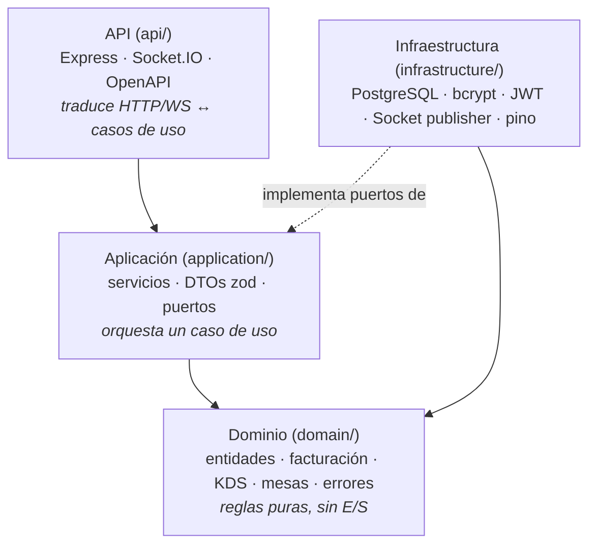
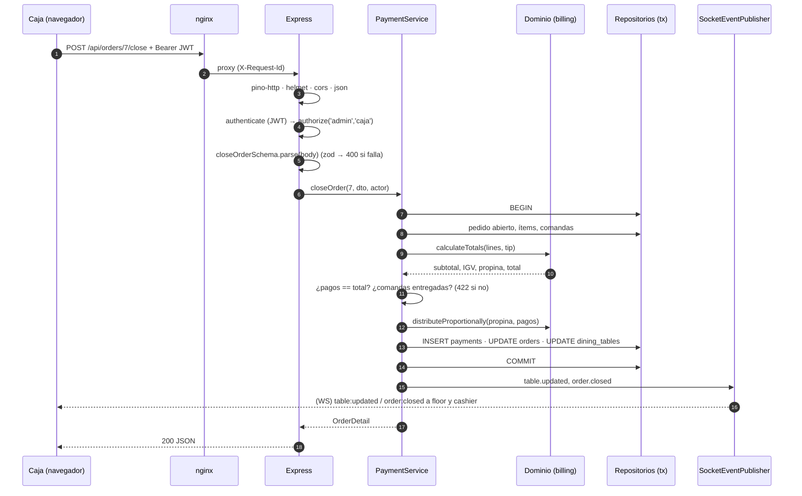
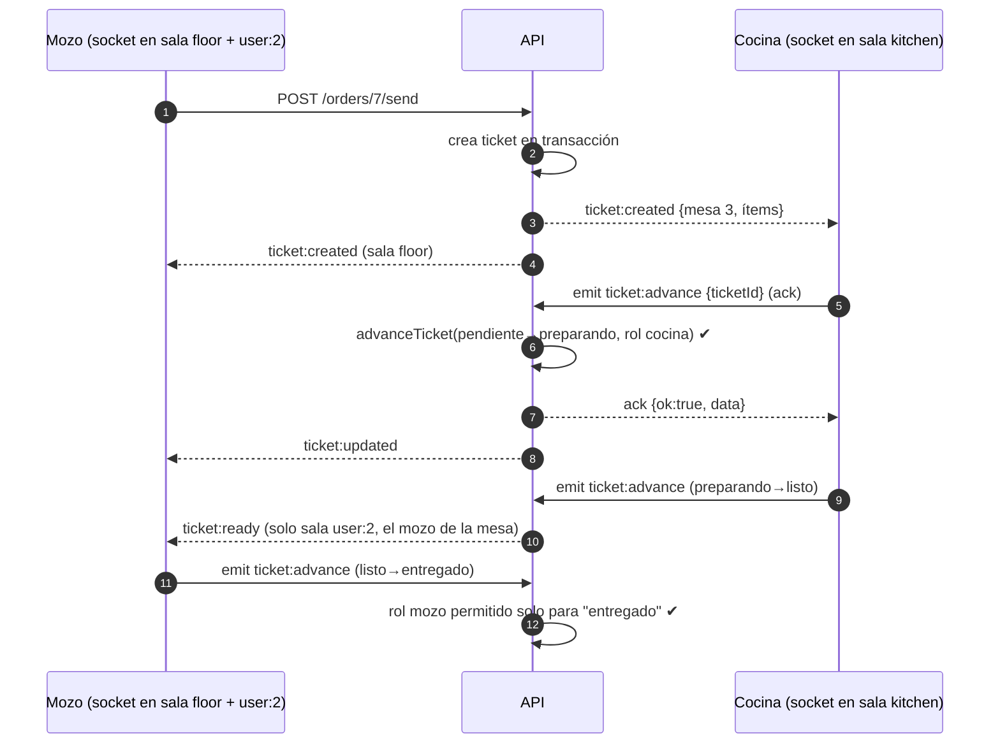

# Arquitectura

Este documento explica cómo está organizado el backend, cómo viaja una petición HTTP y un evento en tiempo real, y las decisiones de diseño más importantes.

## 1. Capas

| Capa | Responsabilidad | Ejemplo | Puede depender de |
| --- | --- | --- | --- |
| **Dominio** | Reglas de negocio puras y deterministas | `splitBill`, `advanceTicket`, `assertTableTransition` | nada |
| **Aplicación** | Casos de uso: cargar, validar reglas, guardar, publicar eventos | `OrderService.sendToKitchen` | dominio, puertos (interfaces) |
| **Infraestructura** | Detalles técnicos que implementan los puertos | `PgOrderRepository`, `JwtTokenService`, `SocketEventPublisher` | aplicación (interfaces), librerías |
| **API** | Entrada/salida: validar DTOs, autorizar, serializar, mapear errores | `routes/index.ts`, `socket-server.ts` | aplicación |

La **raíz de composición** (`src/container.ts`) es el único lugar donde se instancian las clases concretas. Por eso las pruebas pueden cambiar PostgreSQL por pg-mem pasando otra `Database` a `startServer()` sin tocar servicios ni rutas.

### Regla de dependencia

El dominio no importa nada de Express, `pg` ni Socket.IO. Los errores de dominio (`BusinessRuleError`, `ForbiddenError`…) no conocen códigos HTTP: la capa API los traduce (`error-handler.ts`) y el servidor de sockets los traduce a *acks* `{ ok: false, error }`. La misma regla sirve para ambos canales.

## 2. Flujo de una petición HTTP

Ejemplo: `POST /api/orders/7/close` (cobrar una mesa).

Puntos clave:

1. **Validación de forma** (zod) en la capa API → `400` con errores por campo.
2. **Validación de reglas** en servicio/dominio → `422 BUSINESS_RULE`.
3. **Transacción**: los pagos, el cierre del pedido y la liberación de la mesa se confirman juntos.
4. **Eventos después del COMMIT**: si la transacción falla, nadie recibe una notificación falsa.
5. Cualquier error no controlado → `500` genérico (sin filtrar SQL ni stack) y se loguea con el `traceId`.

## 3. Flujo de un evento en tiempo real

Ejemplo: el mozo envía una comanda y cocina la marca como lista.

- **Autenticación en el handshake** (`io.use`): sin JWT válido el socket ni siquiera se conecta.
- **Salas** por rol (`kitchen`, `floor`, `cashier`) y por usuario (`user:<id>`), así cada pantalla recibe solo lo suyo. Emitir a varias salas con `io.to([a, b])` entrega el evento **una sola vez** por socket aunque esté en ambas.
- **Acks**: los eventos cliente → servidor responden siempre `{ ok, data | error }`, con los mismos códigos de error que la API REST.
- **Resincronización**: al reconectar, el KDS vuelve a pedir el tablero por REST por si se perdieron eventos mientras estaba desconectado (los eventos de Socket.IO no son persistentes).

## 4. Decisiones de diseño

| Decisión | Motivo | Alternativa descartada |
| --- | --- | --- |
| Capas + DI manual | Explícito, sin decoradores ni contenedor mágico; fácil de leer para quien aprende | inversify / tsyringe |
| SQL explícito con repositorios | Control total de las consultas y de las transacciones; se prueba con pg-mem | ORM (Prisma/TypeORM) |
| Dinero en céntimos enteros | Evita errores de coma flotante; ver [ADR 0002](decisiones/0002-dinero-en-centimos.md) | `NUMERIC` + decimales en JS |
| pg-mem en pruebas | Pruebas sin Docker usando los mismos repositorios SQL; ver [ADR 0003](decisiones/0003-pruebas-sin-docker-pg-mem.md) | SQLite (otro dialecto) o repos en memoria (no prueban el SQL) |
| Comanda = grupo de ítems enviados juntos | Así trabaja una cocina real: el KDS muestra "la mesa 3 pidió esto" | Estado por ítem individual |
| Copia de nombre/precio en `order_items` | Cambiar la carta no altera cuentas abiertas ni reportes históricos | Leer siempre el precio actual del producto |
| IGV incluido en precio | En Perú el precio al público incluye IGV; se desglosa en la cuenta | Sumar impuesto al final |
| Eventos publicados tras el commit | Nunca notificar algo que luego se revierte | Emitir dentro de la transacción |
| Un pedido abierto por mesa (índice parcial) | La regla se valida en el servicio **y** en la base (defensa en profundidad) | Solo validación en código |
| Mozo solo modifica sus pedidos | Responsabilidad sobre la mesa y sus propinas | Cualquier mozo edita cualquier mesa |
| Cobrar exige comandas entregadas | Evita cobrar platos no servidos y comandas "huérfanas" en el KDS | Permitir cobrar siempre |

## 5. Seguridad

- Contraseñas con **bcrypt** (costo configurable, 12 en producción) y política mínima (8+, letras y números).
- **JWT HS256** con algoritmo fijado al verificar (evita `alg: none`), expiración de 8 h (un turno).
- Autorización **por endpoint** (`authorize(...roles)`) y **por regla de dominio** (p.ej. quién puede mover una comanda a cada estado, mozo dueño del pedido).
- Login con mensaje genérico (no revela qué emails existen); usuarios desactivados no pueden entrar.
- `helmet`, CORS con lista de orígenes, límite de 100 KB en JSON, `redact` de secretos en logs.
- Columnas de orden validadas con **lista blanca** (nunca se concatena input del usuario en SQL).
- Contenedores sin root (`node` y `nginx-unprivileged`).
