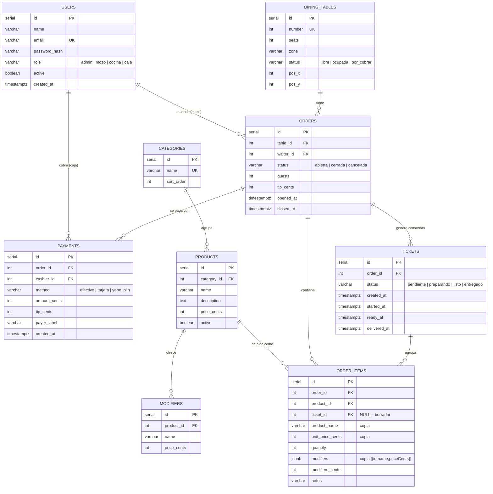

# Modelo de datos

El esquema se crea con migraciones versionadas (`backend/src/infrastructure/db/migrations.ts`), registradas en la tabla `schema_migrations`. Todos los importes son **enteros en céntimos**.

## Diagrama entidad-relación

## Tablas

### `users`
Personal del restaurante. `role` define permisos; `active = false` impide iniciar sesión sin borrar el historial (sus pedidos y cobros siguen referenciándolo). El email es único y se guarda en minúsculas.

### `dining_tables`
Mesas del salón. `status` es el estado visible en el plano y lo cambian **solo** los casos de uso (abrir, pedir cuenta, cobrar, anular), nunca un `PATCH` directo. `pos_x`/`pos_y` ordenan la mesa en el plano y `zone` agrupa (Salón, Terraza).

### `categories`, `products`, `modifiers`
La carta. `products.active = false` lo marca como agotado (no se puede pedir, pero sigue en reportes). Los modificadores pertenecen a un producto y tienen un costo extra opcional (`price_cents = 0` para "sin cebolla").

### `orders`
Un pedido = una ocupación de mesa. El **índice parcial único** `ux_orders_open_table (table_id) WHERE status = 'abierta'` garantiza en la base que una mesa nunca tenga dos pedidos abiertos, incluso si dos mozos tocan la mesa al mismo tiempo. `tip_cents` se fija al cobrar.

### `order_items`
Cada plato pedido. Guarda una **copia** del nombre, precio y modificadores elegidos: si mañana sube el precio del lomo, la cuenta de hoy y los reportes históricos no cambian. `ticket_id IS NULL` significa *borrador* (aún no enviado a cocina; el mozo puede quitarlo). El total de línea es `(unit_price_cents + modifiers_cents) × quantity`.

### `tickets` (comandas)
Grupo de ítems enviados juntos a cocina. Su `status` sigue la máquina de estados del KDS y cada transición registra su marca de tiempo; con ellas se calculan:

- **espera** = `started_at − created_at`
- **preparación** = `ready_at − started_at` (KPI "tiempo medio de preparación")
- **total** = `delivered_at − created_at`

### `payments`
Uno o varios pagos por pedido (cuenta dividida). La suma de `amount_cents` debe ser exactamente `subtotal + propina`; la propina se reparte entre los pagos de forma proporcional (`tip_cents`) para el reporte por mozo.

## Índices

| Índice | Para qué |
| --- | --- |
| `ux_orders_open_table` (parcial, único) | Regla "un pedido abierto por mesa" |
| `ix_orders_table`, `ix_orders_waiter`, `ix_orders_closed_at` | Historial por mesa, reporte por mozo, reportes por fecha de cobro |
| `ix_tickets_status`, `ix_tickets_order` | Tablero del KDS y detalle de pedido |
| `ix_order_items_order`, `ix_order_items_ticket` | Detalle de pedido y armado de comandas |
| `ix_payments_order`, `ix_payments_created` | Detalle de cobro y KPIs por medio de pago |
| `ix_products_category`, `ix_modifiers_product` | Carta filtrada por categoría |

## Datos de ejemplo

`seed.ts` crea (solo si la base está vacía): 5 usuarios demo, 12 mesas en dos zonas, 5 categorías, 14 platos peruanos con modificadores y ~30 pedidos cerrados de los últimos 7 días (generados con una semilla fija, siempre iguales) para que el dashboard y los reportes muestren datos desde el primer arranque. Todo es ficticio.
